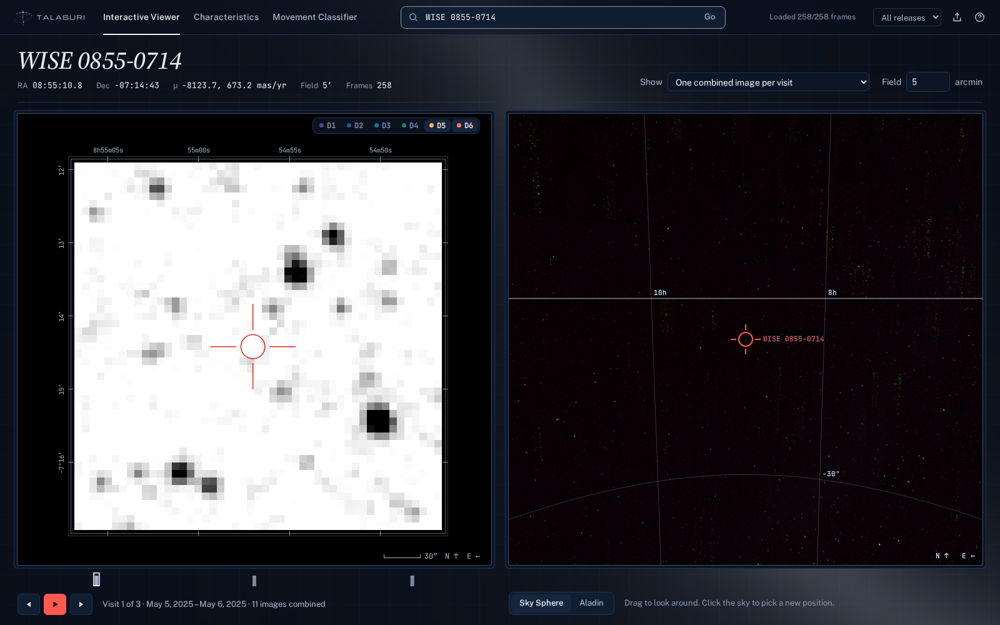
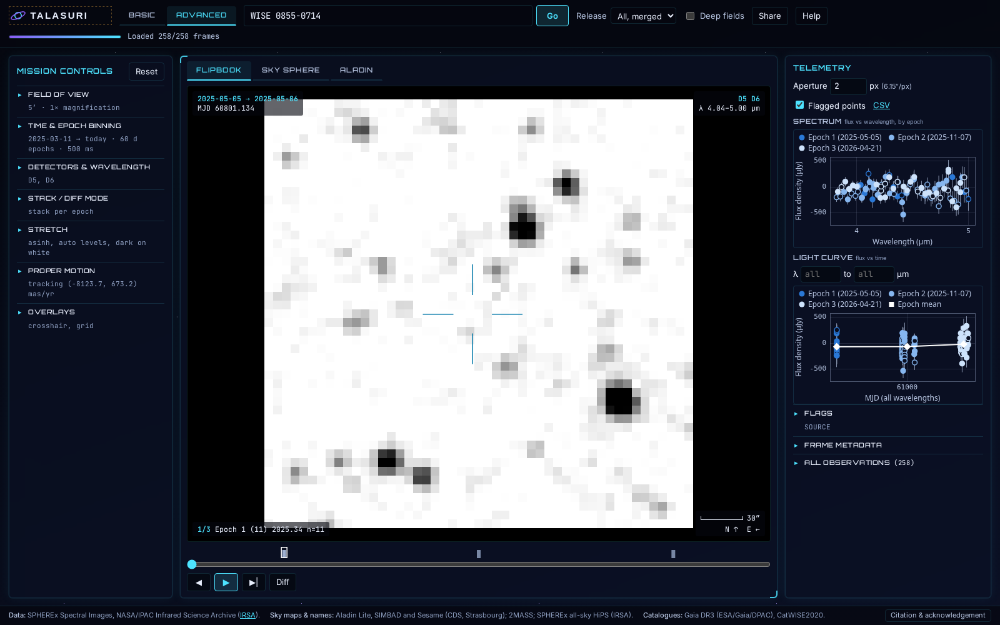
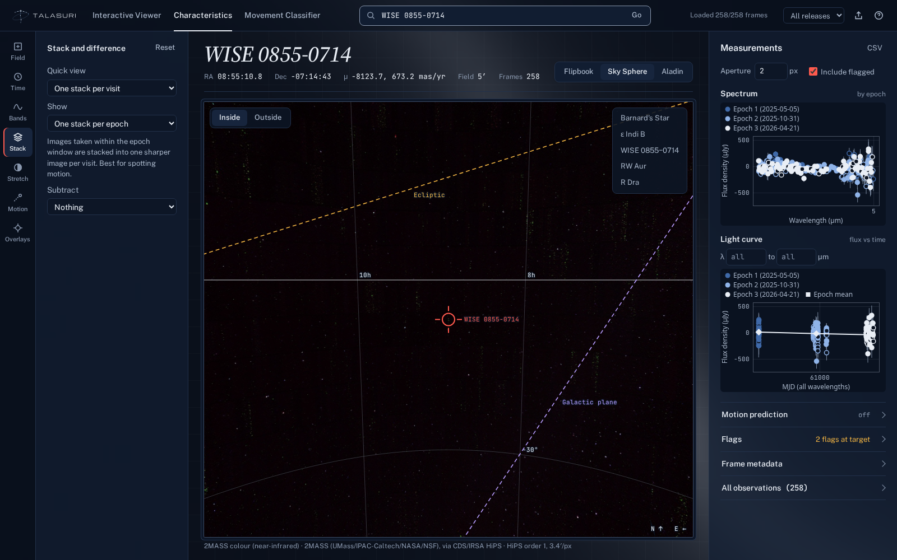
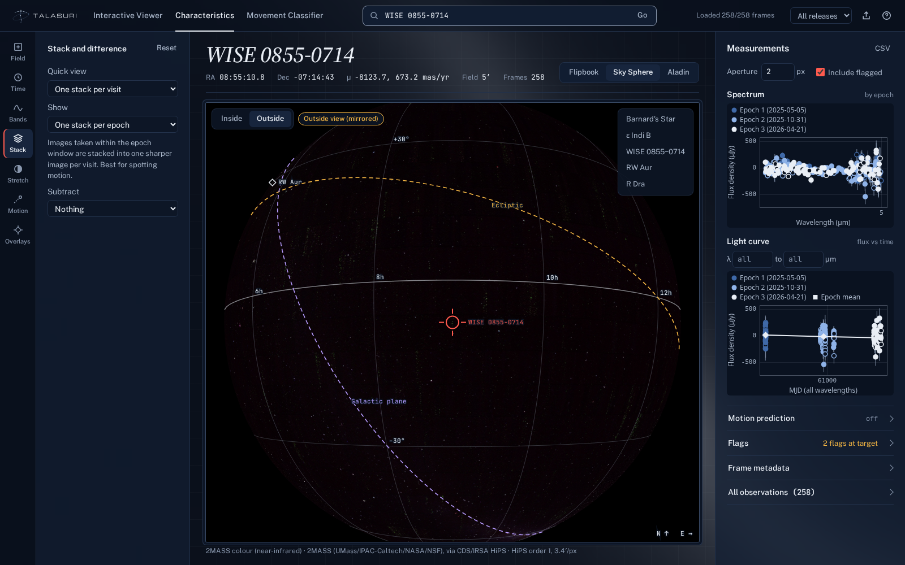
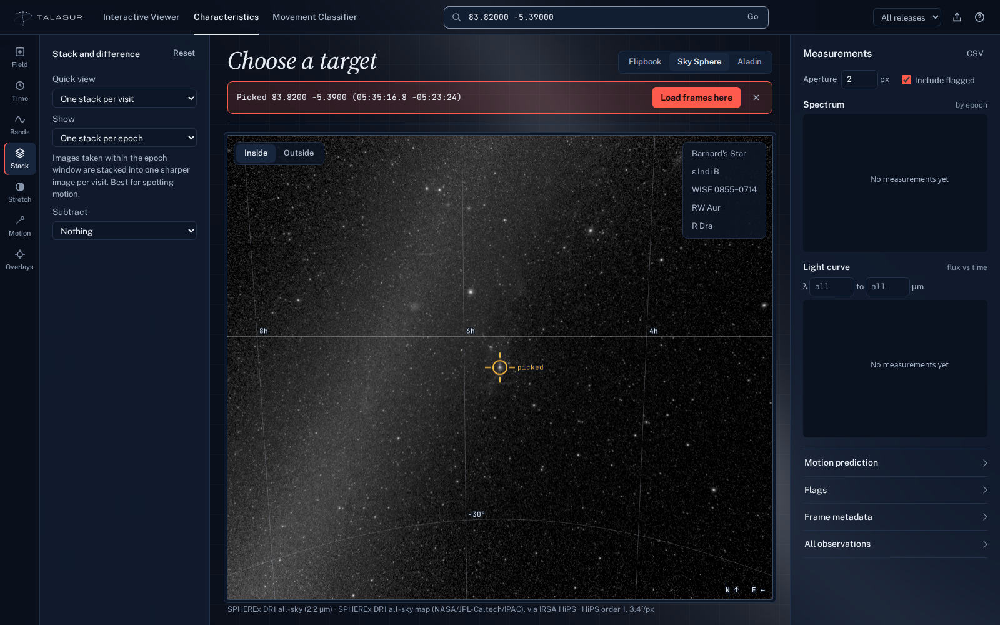
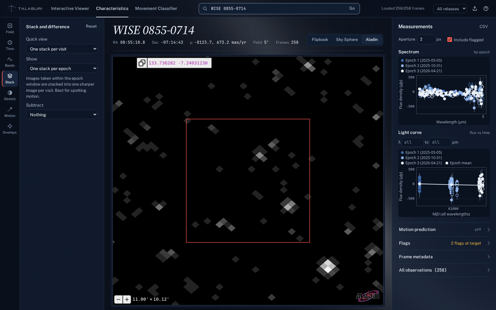
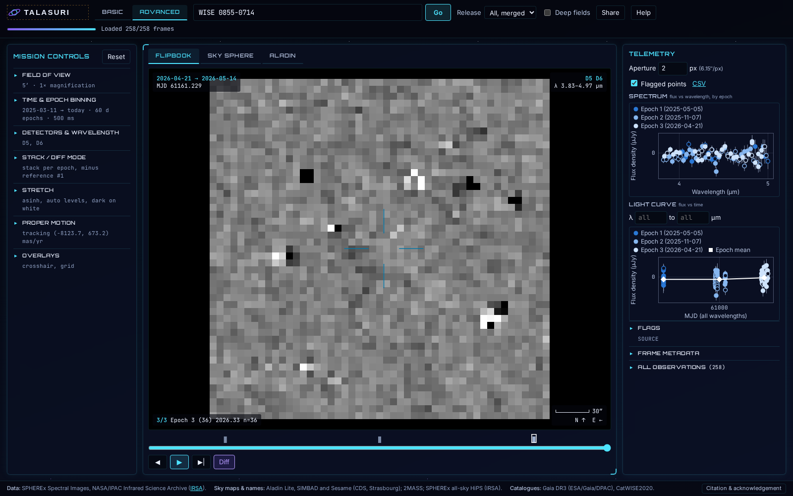
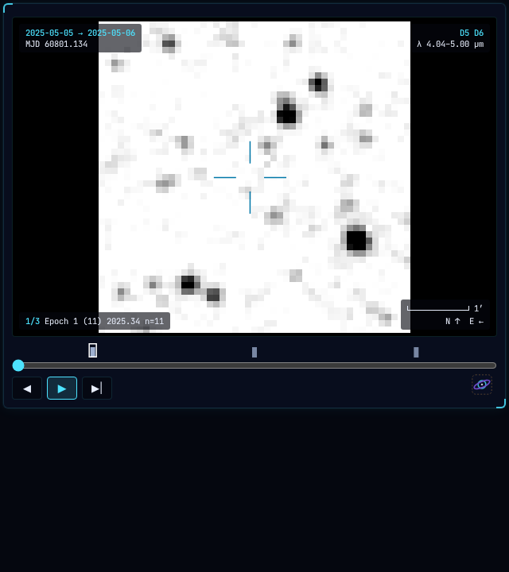
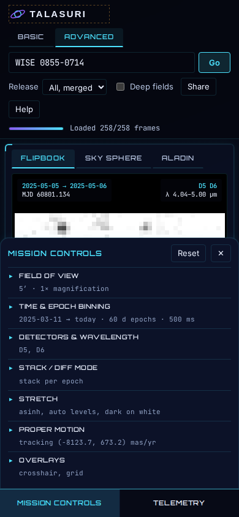

# Talasuri

*Tagalog* tala, "star", + suri, "to examine".

A WiseView-style viewer for NASA's SPHEREx Spectral Images. Enter a position or object name,
or pick one on the sky sphere. Talasuri finds every SPHEREx exposure covering it, cuts out
the region, reprojects everything onto one north-up grid, and plays the frames as a flipbook.
It can also stack frames, subtract a reference, and extract a forced-photometry spectrum and
light curve for the target.

| Interactive Viewer: flipbook and sky map | Characteristics: full console |
|---|---|
|  |  |

| Sky Sphere, inside view (default) | Sky Sphere, outside view (mirrored) |
|---|---|
|  |  |

| Picking a position (SPHEREx layer) | Aladin view |
|---|---|
|  |  |

| Difference imaging | Compact embed (`?embed=1`) | Phone: bottom sheet |
|---|---|---|
|  |  |  |

New to the app? [GUIDE.md](GUIDE.md) walks through opening and using it.
See [docs/TESTING.md](docs/TESTING.md) for acceptance results and [docs/REFACTOR.md](docs/REFACTOR.md) for what
the last refactor changed.

## Quick start

### Local (Python 3.12+, Node 20+)

```bash
python -m venv .venv && .venv/bin/pip install -r backend/requirements-dev.txt
cd frontend && npm ci && npm run build && cd ..
cd backend && ../.venv/bin/uvicorn spherex_viewer.api.app:app --port 8000
# open http://127.0.0.1:8000/#ra=133.81890825&dec=-7.247048&fov=5&pm=1&pmra=-8123.7&pmdec=673.2&dets=5,6
```

To work on the frontend, run `npm run watch` in `frontend/`. It rebuilds `dist/`, and the
backend serves `dist/` at `/`.

### Docker

```bash
docker compose up --build        # http://localhost:8000
```

Downloaded cutouts persist in the `spherex-cache` volume.

## Using it

Three tabs, top left. **Interactive Viewer** (the default) shows only the flipbook and a sky map side by
side, with a *Show* preset and the field size: pick a position, press play. **Characteristics** is
the full console described below. **Movement Classifier** lists the sources in the field that may be
moving (see [Mover candidates](#mover-candidates)). The open tab is saved in the URL
(`tab=basic|adv|movers`). The app opens on a title screen; a click or any key dismisses it
(`?embed=1` skips it). The title screen also sets the interface language, English or
Filipino; the choice is kept in the browser (`localStorage`) and the dictionary lives in
`frontend/src/i18n.ts`.

- **Header:** logo, target search (name or RA/Dec, with suggestions), release selector,
  *Share* (link, compact-player link, iframe code) and *Help* (guide, example targets,
  shortcuts, credits). A search turns motion tracking on by itself: with the catalogue
  proper motion when the name has one, otherwise with the Gaia DR3 motion of the star at
  that position if it moves at least 50 mas/yr (also for typed coordinates).
- **Defaults, chosen for spotting motion:** one stacked image per visit (60 day epoch
  window), dark objects on a white sky, automatic levels that keep the sky flat (black point
  at sky + 1σ on star fields), and tracking of the target's proper motion. Difference
  images are centred on zero (each one's median removed) and stretched the same on both
  sides, so an unchanged sky is mid-grey. All of this is display or grouping: every control
  can be changed in Characteristics, and FITS downloads and photometry use the unaltered pixels
  (difference FITS files do carry the median removal).
- **Settings** (left): a labelled rail (Field, Time, Bands, Stack, Stretch, Motion,
  Overlays). Each item opens its section in a flyout beside the image: field of view (and
  deep fields), time and epoch binning, detector and wavelength filters, stack and
  difference, stretch (and bad-pixel flags), proper motion, and overlays. Pressing the item
  again, or Esc, closes the flyout and gives the room back to the image.
- **Viewport** (centre): the target's name and position above it, like an atlas plate,
  and three tabs:
  - **Flipbook:** the images, with a scale bar in one corner and a crosshair on the
    target; one line under the player gives frame n/N, date, MJD, detector and λ. Below it, a timeline with one tick per frame
    coloured by detector (amber cap = target pixel flagged), the scrubber and the player.
  - **Sky Sphere:** the whole sky (Three.js). *Inside* (default) puts the camera at the
    centre of the celestial sphere: north up, east left. *Outside* shows the sky as a globe;
    that view is mirror-reversed (east right) and says so. Drag to look around, scroll to
    zoom, click to pick a position, then *Load frames here*. Zooming in loads the
    survey's own HiPS tiles, down to its full resolution (2MASS 0.8″ per pixel, the SPHEREx
    map 13″); the line under the view gives the current HiPS order and scale. Overlays: RA/Dec grid,
    ecliptic, galactic plane, the target reticle, and the five test targets as presets.
  - **Aladin:** Aladin Lite with the loaded field, catalogue overlays and a choice of
    imagery (SPHEREx all-sky map following the frame wavelength, unWISE, 2MASS, DSS2).
- **Measurements** (right): spectrum, light curve, motion prediction (below), flag readout,
  frame metadata (with FITS and IRSA links) and the list of all observations.
- **Help** holds the data credits and acknowledgements. On a phone the settings and
  measurements become bottom sheets.

Images are never tinted or styled: greyscale is a neutral ramp, and the only colour added is
the bad-pixel highlight you switch on yourself.

### Motion prediction from WISE epochs

*Measurements → Motion prediction → Predict the position from WISE epochs* (`wfit=1` in the
URL). The backend reads every WISE and NEOWISE **single-exposure** detection along the
target's 2010–2024 track from IRSA, keeps those within 3″ of the track, averages them per
visit and fits position, proper motion and parallax by weighted least squares
(`processing/astrometry.py`). It then predicts the position at the date of each SPHEREx
image, with the covariance propagated from the fit.

- **On the image:** a mark with four diagonal ticks at the predicted position, and the
  **95% uncertainty ellipse drawn to scale**. For a well-measured object the ellipse is far
  smaller than a 6.15″ SPHEREx pixel, which is why the ticks are there.
- **In Measurements:** the fitted values with errors, the prediction for the image on screen
  (ellipse axes, position angle, distance from the crosshair), and a plot of position minus
  straight-line motion against time: WISE visits, the fitted parallax wobble, and the ±1σ
  band of the prediction, which widens after the last WISE visit in 2024.
- ***Track with this motion*** makes the fitted position and proper motion the tracked
  target. Session tracking is linear; the prediction mark keeps showing the parallax.

This is a physical model, not machine learning: for one object's motion the model is known,
least squares is the best estimator, and its error bars mean what they say. A unit test
checks that the true position falls inside the 95% ellipse in about 95% of simulated data
sets. Checked live (Nov 2026); published motions are SIMBAD's:

| Object | Fitted μ (mas/yr) | Published μ | Fitted parallax (mas) | Published |
|---|---|---|---|---|
| WISE 0855−0714 | −8132.9 ± 9.1, +681.7 ± 10.4 | −8123.7, +673.2 | 491 ± 37 | 439 |
| Barnard's Star (saturated) | −787.6 ± 14.3, +10375.2 ± 10.7 | −801.6, +10362.4 | 458 ± 56 | 547 |
| ε Indi B (a close binary) | +3990.1 ± 3.5, −2514.0 ± 3.4 | +3982.0, −2466.8 | 269 ± 13 | 275 |

Limits:

- The errors are statistical, scaled up when the fit is poor, with a 40 mas per-visit floor
  for single-exposure frame systematics. Orbital motion of an unresolved binary is not in
  the model. ε Indi B's fitted motion in declination differs from SIMBAD's by far more than
  the quoted error; it is a close binary, which is the likely cause, but that is not verified.
- The ellipse does not include any offset between the WISE and SPHEREx reference frames.
- A starting motion is needed for anything faster than about 3″ per half year, because the
  detections are chained visit to visit within the 3″ match radius. A name search supplies
  one; otherwise the CatWISE2020 motion at the position is tried. When fewer than half the
  WISE visits yield a detection, the fit carries a warning.
- Objects too faint for single WISE exposures (roughly W1 > 15, W2 > 14.5) cannot be fit.

### Mover candidates

The **Movement Classifier** tab lists the CatWISE2020 sources in the loaded field whose catalogued
proper motion is significant (S/N ≥ 3), ranked by a classifier's probability that the
source really moves by at least 50 mas/yr. Rings on the flipbook mark the listed sources;
likely movers are drawn where their motion puts them at each image's date. Selecting a row
shows the CatWISE and Gaia values, and *Open as target* loads it with tracking and a WISE
motion fit, which is the check that matters.

CatWISE fits a motion to every source, and most significant-looking motions of faint
sources are blends, artifacts or noise. The classifier (`processing/movers.py`,
gradient-boosted trees) learns which are real from CatWISE's own quality columns: the
fit's χ², blend counts, artifact flags, ascending/descending-scan consistency, parallax
terms, variability indices, detection fractions, and so on. The truth is the Gaia DR3
proper motion of the same star.

Trained on 162,029 Gaia-labelled CatWISE sources (7,858 movers) from 150 random 30′
fields, plus 1,707 CatWISE entries of 1,589 confirmed brown dwarfs from SIMBAD (object type
`BD*`, catalogued motion ≥ 50 mas/yr, CatWISE motion agreeing with SIMBAD's) as movers that
Gaia cannot supply. Scores on the Gaia-labelled sample, 5-fold cross-validation with whole
fields held out:

| | Precision at P ≥ 0.5 | Recall | Average precision | ROC AUC |
|---|---|---|---|---|
| Classifier | 84% | 65% | 0.81 | 0.973 |
| Ranking by CatWISE motion S/N alone (same number flagged) | 62% | 48% | 0.55 | 0.875 |

Brown dwarfs, each scored by a model that never saw it (held out in groups):

| | Flagged at P ≥ 0.5 | Same entries, model trained on Gaia truth alone |
|---|---|---|
| All 1,707 entries | 93% | 86% |
| The 860 with no Gaia star | 89% | 76% |
| WISE 0855−0714 (two CatWISE entries) | P = 0.98, 0.81 | P = 0.02, 0.01 |

Without the brown dwarfs the model had learned that a CatWISE motion of several arcsec per
year is spurious, which is true of nearly every such claim among stars Gaia sees.

**What is still unknown.** For sources with no Gaia star there are confirmed movers but no
confirmed non-movers, so precision there cannot be measured. As a bound on over-eagerness:
of 344,360 such candidates in the random fields (truth unknown, most surely not movers) the
model flags 0.06% (0.02% before the brown dwarfs were added), about 1.4 per 30′-radius
field. The tab also lists sources with **no Gaia star and a CatWISE motion S/N ≥ 10** in a
separate table, sorted by significance and shown whatever their probability, so a low score
never hides one. SIMBAD's brown dwarfs are themselves mostly found by their motion in WISE
data, so the held-out recall above is for objects like those already known.

Limits, also stated in the tab:

- For a source **not in Gaia**, which is what a new cold brown dwarf would be, recall is
  measured (above) but precision is not. A high probability is a reason to look.
- Training fields are at Galactic latitude |b| ≥ 15°. In the plane the model is outside its
  training range.
- W1 − W2 colour is deliberately not a feature, so the model cannot learn "red" as a
  stand-in for "not in Gaia".

Retrain (needs `scikit-learn` from `requirements-dev.txt`, IRSA and SIMBAD access, about
30 minutes for the first download, under a minute after; the server itself only needs
numpy; `--no-brown-dwarfs` trains on Gaia truth alone):

```bash
cd backend && ../.venv/bin/python -m spherex_viewer.train_movers --fields 150
```

The model is `spherex_viewer/data/mover_model.json`: plain JSON trees, evaluated with numpy.
It carries rows scored by scikit-learn at training time, and a unit test checks that the
numpy evaluator reproduces them.

**Keyboard:** Space play/pause, ← → step, **D** difference imaging on/off, **S** Sky Sphere
on/off, **?** help. On the sphere: arrows look around, + − zoom, Enter picks the centre.

### URL parameters

Every setting lives in the URL hash, e.g.
`#ra=133.79513&dec=-7.24515&fov=5&mode=epoch&speed=500&stretch=asinh&diff=0&gaia=1`.
The full list, with types and defaults, is the `SCHEMA` object in `frontend/src/state.ts`
(the single definition). New with the Talasuri redesign:

| Parameter | Values | Default | Meaning |
|---|---|---|---|
| `tab` | `basic`, `adv` | `basic` | Interactive Viewer or Characteristics |
| `view` | `flipbook`, `sphere`, `aladin` | `flipbook` | which viewport tab is open (Characteristics) |
| `sphere` | `inside`, `outside` | `inside` | sky-sphere camera mode |
| `map` | `sphere`, `aladin` | `sphere` | the sky map shown beside the flipbook (Interactive Viewer) |
| `slayer` | `2mass`, `dss`, `spherex` | `2mass` | sky-sphere texture |
| `sgrid`, `secl`, `sgal` | `0`, `1` | `1`, `0`, `0` | RA/Dec grid, ecliptic, galactic plane |
| `pra`, `pdec` | degrees | none | a picked position not yet loaded |

Older links keep working (`tab=about` opens Interactive Viewer; the guide is now the Help dialog).
Add `?embed=1` for the compact player (viewport, player controls, symbol watermark).

### Branding: swapping the logo and symbol

The logo is a constellation drawn as a "T" beside the TALASURI wordmark. The master file
is `frontend/assets/logo-light.svg` (dark ink, for light backgrounds); the app uses two
versions derived from it for its dark interface:

| File | Used for |
|---|---|
| `frontend/assets/logo-light.svg` | master artwork, for light backgrounds (not used by the app) |
| `frontend/assets/logo.svg` | the header logo and the title screen: the master recoloured to chalk `#e9eef5` and blue `#8fb3e8` |
| `frontend/assets/symbol.svg` | favicon, loading spinner, embed watermark: the constellation mark alone on chart navy, with heavier lines for small sizes |

To change the artwork, replace these files (keep the names) and run `npm run build`. No code
changes are needed; each slot is marked with an HTML comment in `frontend/index.html`.
Colours, fonts and timings are CSS custom properties in `frontend/src/theme.css`.

### Sky textures

The whole-sky view is a static image from `frontend/assets/sky/`, rendered once by a build
step:

```bash
.venv/bin/python scripts/build_sky_textures.py          # missing layers only; --force to redo
```

Layers, size and the default are set in `frontend/sky.config.json`. For each layer the
script asks CDS hips2fits for an all-sky CAR image and, if that fails, resamples the
survey's own HiPS `Norder3/Allsky` mosaic. A layer that could not be built is shown as
"(not built)" in the menu.

Those images hold about 5′ per pixel. Once the view needs more, the sphere draws HiPS tiles
over them (`frontend/src/healpix.ts`, unit tested against astropy-healpix): each layer's
`tiles` entry in `sky.config.json` names the HiPS root and its deepest order. 2MASS tiles
come straight from IRSA; SPHEREx tiles come through this app's cached proxy
(`/api/hips/spherex/{slice}/…`). Tiles are shown as published, with no restretching. If the
archive does not answer, the static image stays and the status line says so.

## Architecture

```
backend/spherex_viewer/
  config.py              settings (env vars SPX_*)
  coords.py              coordinate parsing, formatting, range check (twin of frontend coords.ts)
  releases.toml          optional release overrides (labels / hide / priority)
  data_access/
    releases.py          release registry + periodic discovery from IRSA TAP
    http.py              the one shared HTTP session
    resolver.py          CDS Sesame, proper-motion propagation
    sia.py               SIA2 queries per collection, cached; dedupe across releases
    cutouts.py           cutout fetching (S3 first, IBE fallback), retry/backoff, disk cache
    s3cutouts.py         cutouts from byte ranges of the public S3 copy of the archive
    fitsmeta.py          HDUs, celestial + spectral WCS, FLAGS bit definitions
    catalogs.py          Gaia DR3 / CatWISE2020 cone searches, WISE single-exposure
                         detections, mover candidates (IRSA Gator)
    hips.py              SPHEREx all-sky HiPS cube re-served per slice as image HiPS, tile cache
  processing/
    grid.py              common TAN grid (north up, 6.15"/px, centred on target)
    pipeline.py          reproject -> stack -> difference, with the mode as a parameter
    photometry.py        forced aperture photometry on native pixels
    render.py            display limits, stretches, flag overlay, lossless WebP/PNG
    astrometry.py        position + proper motion + parallax fit to WISE epochs; prediction
                         with its error ellipse
    movers.py            mover classifier: features, numpy tree evaluator, Gaia matching
  api/
    sessions.py          one session per (target, FOV, release, PM): background pipeline + SSE
    app.py               FastAPI routes, static frontend
  checks.py              live acceptance checks (also: python -m spherex_viewer.checks)
  train_movers.py        trains the mover classifier (python -m spherex_viewer.train_movers)
frontend/src/            state.ts (URL schema + hash store), coords.ts, api.ts, player.ts (canvas,
                         timeline), plots.ts (canvas plots), motion.ts (motion-fit plot), sphere-math.ts + sphere.ts (Three.js,
                         lazy), aladin.ts (Aladin Lite v3, lazy), theme.css, app.css, main.ts
frontend/assets/         logo.svg, logo-light.svg, symbol.svg, sky/*.jpg (static sky textures)
shared/coords_cases.json coordinate cases run by both the Python and the TypeScript tests
```

How a search runs: `POST /api/sessions` → SIA query per collection → frame list → cutouts
fetched in parallel (cached ones first, then in time order) → each cutout is processed in a
thread pool (λ at target, photometry, reprojection) → an SSE `frame` event fires. The UI
shows frames as they land. Products such as stacks and differences are computed on request
from the in-memory reprojected frames and LRU-cached per parameter set.

### API

| Endpoint | Purpose |
|---|---|
| `GET /api/releases` | registry (collections, releases) |
| `GET /api/resolve?q=` | coordinates or Sesame name → RA/Dec (+PM) |
| `POST /api/sessions` | start or reuse a search; returns a snapshot |
| `GET /api/sessions/{id}/events` | SSE: `progress`, `observations`, `frame`, `done` |
| `GET /api/sessions/{id}/products?mode=&window=&dets=&lam_min=&lam_max=&mjd_min=&mjd_max=&diff=&ref=` | product list + shared display limits |
| `GET /api/sessions/{id}/products/{idx or frame key}.webp?…&stretch=&vmin=&vmax=&invert=&flagmode=&flagbits=` | frame image, lossless WebP (`.png` also works) |
| `GET /api/sessions/{id}/products/{idx}.fits?…` | on request only: FITS (IMAGE, VARIANCE, FLAGS, NUSED) on the common grid |
| `GET /api/sessions/{id}/photometry?…&r_ap=&r_in=&r_out=&format=json\|csv` | spectrum / light-curve table |
| `GET /api/catalog/{gaia\|catwise}?ra=&dec=&radius=` | overlay sources with PM and epoch |
| `GET /api/gaia_pm?ra=&dec=&epoch=` | Gaia DR3 proper motion for the target |
| `POST /api/wise_motion` `{ra, dec, epoch, pmra, pmdec, mjds}` | fit to the WISE epochs; predicted position and 1σ error ellipse at each MJD |
| `GET /api/movers?ra=&dec=&radius=` | CatWISE sources with a significant motion, ranked by P(really moving) |
| `GET /api/hips/spherex/{slice}/…` | one slice of the SPHEREx all-sky HiPS as an image HiPS (cached tiles) |

## Configuration

All settings are environment variables:

| Variable | Default | |
|---|---|---|
| `SPX_CACHE_DIR` | `~/.cache/spherex_viewer` | cutouts, SIA results, catalogs |
| `SPX_CUTOUT_SOURCE` | `auto` | `auto` = S3 byte ranges with IBE as fallback; `s3` or `ibe` to force one |
| `SPX_S3_CONCURRENCY` | 128 | parallel S3 range requests (latency-bound; S3 doesn't throttle at this level) |
| `SPX_S3_BASE_URL` | `https://nasa-irsa-spherex.s3.us-east-1.amazonaws.com` | public bucket `s3://nasa-irsa-spherex` |
| `SPX_FETCH_CONCURRENCY` | 8 | parallel IBE cutout requests; IRSA returns 503s at ~16 |
| `SPX_FETCH_TIMEOUT_S` / `SPX_FETCH_RETRIES` | 90 / 5 | per request; exponential backoff with jitter |
| `SPX_SIA_CACHE_TTL_S` | 21600 | how long a SIA result is reused (new data appears after this) |
| `SPX_REGISTRY_REFRESH_S` | 21600 | collection discovery interval |
| `SPX_SPHEREX_HIPS_URL` | IRSA `.../hips/SPHEREx/spherex_allsky_cube` | upstream of the sky-map tile proxy |
| `SPX_RELEASES_FILE` | `backend/spherex_viewer/releases.toml` | registry overrides |
| `SPX_MAX_FOV_ARCMIN` / `SPX_WARN_FOV_ARCMIN` | 30 / 10 | |
| `SPX_MAX_SESSIONS` | 8 | in-memory sessions (LRU) |
| `SPX_IRSA_SIA_URL`, `SPX_IRSA_TAP_URL` | IRSA | service endpoints |
| `SPX_SESAME_URLS` | CDS, then CfA mirror | comma-separated, tried in order; resolved names are cached on disk |

The cache never needs invalidating: the product URL, which includes IRSA's processing
version, is hashed into each cutout's filename. You can delete it at any time.

Every IBE cutout carries the detector's whole PSF table (~3.8 MB). Before caching, it is
cut to the 4 PSFs nearest the cutout, so a cached cutout is ~0.2 MB instead of ~4 MB.
Caches created by older versions can be slimmed in place:

```bash
cd backend && ../.venv/bin/python -m spherex_viewer.maintenance slim-cache   # or: stats
```

## Adding a new data release

Usually **nothing to do**. Every 6 h (and at startup) the registry asks IRSA's TAP service
which `spherex_*` collections have data at the two ecliptic poles. SPHEREx observes the
poles continuously, so every sky collection appears there. Two indexed cone queries take
~30 s, compared with >5 min for a full `GROUP BY` over the ObsCore table. A new collection
named like `spherex_qr4` or `spherex_dr2_deep` is picked up automatically, parsed into
release `qr4`/`dr2` and variant `wide`/`deep`, and given a priority (DR > QR, higher
numbers win) for deduplication. New *observations* in existing collections appear as soon
as the SIA cache entry expires.

Edit `releases.toml` only to:
- hide a collection (`[hide] collections = [...]`, e.g. `spherex_dr1_cal`),
- relabel one (`[labels]`),
- override deduplication priority (`[priority] spherex_qr4 = 150`).

If IRSA changes the naming scheme, update `parse_collection_name()` in
`data_access/releases.py` and `BOOTSTRAP_COLLECTIONS`, the list used until the first
discovery succeeds.

## Name suggestions

The search box suggests names from a built-in index of ~32,000 well-known objects
(`backend/spherex_viewer/data/names.json.gz`, 0.8 MB): every SIMBAD proper name, Messier/NGC/IC
objects, and stars and variables with many literature references, ranked by how often each
object is cited. A few aliases for famous objects with unfriendly catalogue names (e.g.
"WISE 0855-0714") are listed in `build_names.py`. Designations outside the index are
searched live in SIMBAD (CfA mirror first, then CDS) and cached for an hour.

Rebuild the index (about a minute) to pick up new SIMBAD names or aliases:

```bash
cd backend && ../.venv/bin/python -m spherex_viewer.build_names
```

## Tests

```bash
cd backend && ../.venv/bin/pytest                         # offline unit tests (81)
cd backend && ../.venv/bin/pytest -m network              # live acceptance tests (slow)
cd backend && ../.venv/bin/python -m spherex_viewer.checks wise0855 --out ../results/wise.json
cd frontend && npm test                                   # URL schema, coordinates, sky-sphere geometry (25)
python scripts/screenshots.py                             # headless screenshots of every view (server on :8000)
```

## Data notes, verified against the live services (Nov 2026)

- HDUs: `IMAGE` (MJy/sr, **zodi not subtracted**), `FLAGS`, `VARIANCE`, `ZODI`, `EPSF`
  (binary table of 33×33 PSFs on a grid of detector positions), `WCS-WAVE`.
- Wavelength at a pixel comes from `WCS(header, fobj=hdul, key="W")` with `.sip = None`.
  IBE cutouts shift `CRPIXnW`, so this works on cutouts. A unit test checks it against
  direct interpolation of the lookup table.
- **Where cutouts come from.** By default they're built from byte ranges of the public S3
  copy of the archive (`s3://nasa-irsa-spherex`, same paths as IBE below
  `/ibe/data/spherex/`). The tool reads the HDU headers, then only the rows covering the
  field from IMAGE, VARIANCE, ZODI and the RICE-compressed FLAGS plane (one tile per row,
  so single rows can be fetched and decoded). The result has the same structure and WCS
  conventions as an IBE cutout. 24 real cutouts were identical to IBE's, pixel for pixel,
  in all planes, WCS and wavelengths, and a full acceptance run gives identical results.
  Header offsets learned from one file are reused for the next (two round trips per file).
  Any image S3 can't serve falls back to IBE automatically.
- **Speed.** A first load runs 5–7 frames/s via S3 (e.g. 373 frames in 58 s, 258 in 41 s),
  against ~0.4–0.75/s through IBE, whose cutouts each carry the 3.8 MB `EPSF` table and
  are throttled. Cached reloads take seconds.
- Each frame's time is `MJD-AVG` (UTC, exposure midpoint).

## Citation and acknowledgement

If you use data obtained with this tool, please include:

> This publication makes use of data products from the Spectro-Photometer for the History
> of the Universe, Epoch of Reionization and Ices Explorer (SPHEREx), which is a joint
> project of the Jet Propulsion Laboratory and the California Institute of Technology, and
> is funded by the National Aeronautics and Space Administration.

> This research has made use of the NASA/IPAC Infrared Science Archive, which is funded by
> the National Aeronautics and Space Administration and operated by the California
> Institute of Technology.

IRSA also asks authors to cite each dataset's DOI and canonical paper (listed on the
[IRSA SPHEREx page](https://irsa.ipac.caltech.edu/Missions/spherex.html)), and to add
"IRSA" as a facility keyword in AAS journals ([IRSA acknowledgement](https://irsa.ipac.caltech.edu/ack.html)).
Overlays use CDS Sesame, Aladin Lite, Gaia DR3 (ESA/DPAC) and CatWISE2020. The motion fit
uses the WISE All-Sky, 3-Band Cryo, Post-Cryo and NEOWISE-R Single Exposure Source Tables
(NASA/IPAC IRSA). Please acknowledge them as their providers request.
