# Testing

Results from 2026-11-14, against live IRSA services (DR1 + QR3 merged; deep collections
off). Raw output: `results/acceptance.json`. To reproduce:

```bash
cd backend
../.venv/bin/pytest                                  # 66 offline unit tests
../.venv/bin/pytest -m network                       # live acceptance tests (pytest wrapper)
../.venv/bin/python -m spherex_viewer.checks --out ../results/acceptance.json
cd ../frontend && npm test                           # 19 tests: URL schema, coordinates, sky sphere
```

## Automated checks per target

Every target is resolved by name with CDS Sesame and tracked with its Sesame proper motion
(epoch J2000). The checks are:

1. **Frames**: SIA returns observations and the cutouts load.
2. **Alignment**: in every single reprojected frame, bright, isolated, unsaturated field
   stars (peak > 20σ) are centroided and compared with their position in that detector's
   stack. The criterion is RMS < 1 px.
3. **Spectrum**: forced photometry yields at least one measured flux, and the spectrum
   spans 0.75–5 µm.
4. **Motion** (extra check): the target's centroid in each 60-day epoch stack is compared
   with the position predicted from its proper motion.

| Target | Frames (loaded) | Span (MJD) | Align: stars measured | median / RMS / p95 (px) | Spectrum: measured / unflagged / saturated | Motion: predicted → measured (px), max residual | Result |
|---|---|---|---|---|---|---|---|
| WISE 0855−0714 | 258 (258) | 60801–61174 | 434 | 0.08 / 0.49 / 1.37 | 258 / 203 / 1 | 1.31 → 1.09, 0.21 (D5+D6) | **PASS** |
| Barnard's Star | 358 (358) | 60903–61306 | 1673 | 0.05 / 0.20 / 0.14 | 222 / **0** / 357 | 1.66 → 1.73, 0.12 | **PASS** (photometry saturated) |
| ε Indi B (5′) | 458 (458) | 60790–61315 | 1325 | 0.06 / 0.41 / 0.67 | 458 / 355 / 3 | 1.05 → 0.98, 0.15 | **PASS** |
| ε Indi A+B (15′) | 458 (458) | 60790–61315 | 2090 | 0.07 / 0.36 / 0.27 | 458 / 355 / 3 | 1.05 → 0.98, 0.15 | **PASS** |
| RW Aur | 335 (335) | 60919–61300 | 1363 | 0.05 / 0.31 / 0.21 | 334 / 18 / 306 | (PM negligible) | **PASS** (photometry saturated) |
| R Dra | 539 (539) | 60812–61238 | 780 | 0.24 / 0.46 / 0.93 | 31 / **0** / 534 | (PM negligible) | **PASS** (photometry saturated) |

Timing:
- **Cold cache**, first visit to a target: 250–350 s at 8 parallel requests, about 0.75
  cutouts/s.
- **Warm cache**, timings in the table above: 10–18 s at the time. After the
  optimisation pass: 2.7 s (WISE 0855, 258 frames) and 6.0 s (R Dra, 539 frames), and
  the whole live suite runs in 38 s (was 110 s).
- **Fetch failures:** the first cold runs lost 2–4 cutouts per target after 6 attempts
  (HTTP 503 throttling). Each was recovered on a later run or with "Retry failed".

## Acceptance criteria from the brief

### Barnard's Star: motion across epochs ✅ (photometry ❌, saturated)
- Three epoch stacks between 2025.66 and 2026.64. The measured displacement, 1.73 px
  (10.6″), matches the proper-motion prediction of 1.66 px to within 0.12 px.
- The "last minus first epoch" difference shows the expected north–south dipole.
- Barnard's Star (J ≈ 5) is **saturated in 357/358 frames**: OVERFLOW, SUR_ERROR and BLOOM
  at the target, and the pipeline blanks the core in 136 frames. The UI flags this, and no
  flux is reported where the aperture is more than 20% blank. Aperture photometry can't
  give a usable spectrum for a star this bright.

| First epoch | Last epoch | Last − first |
|---|---|---|
| 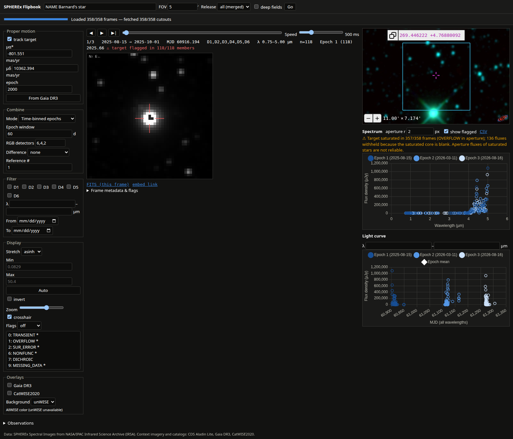 | 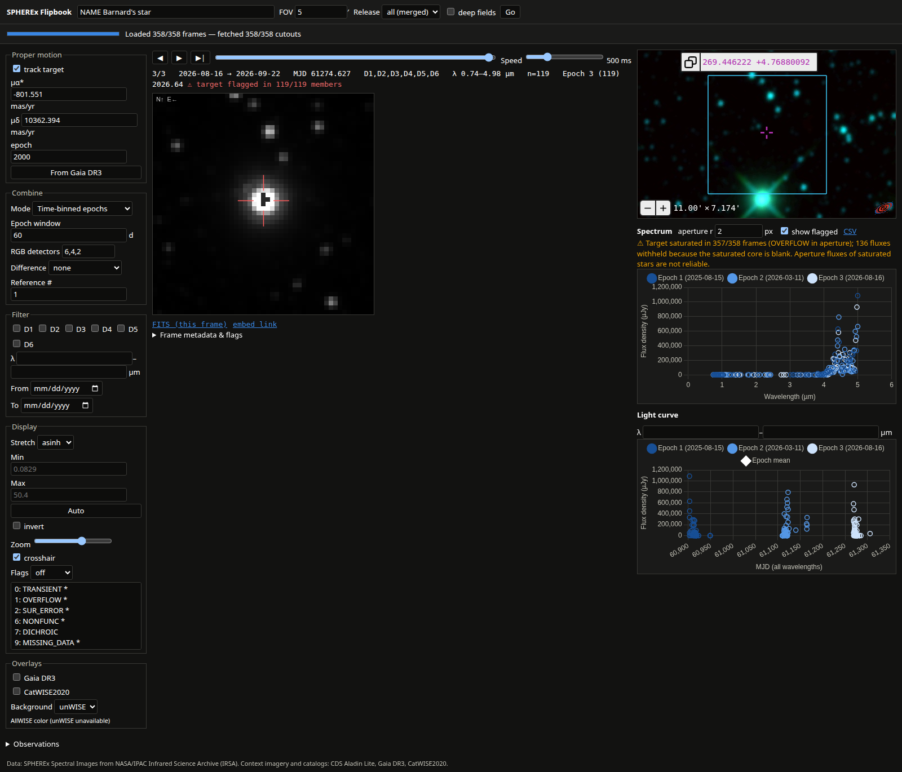 | 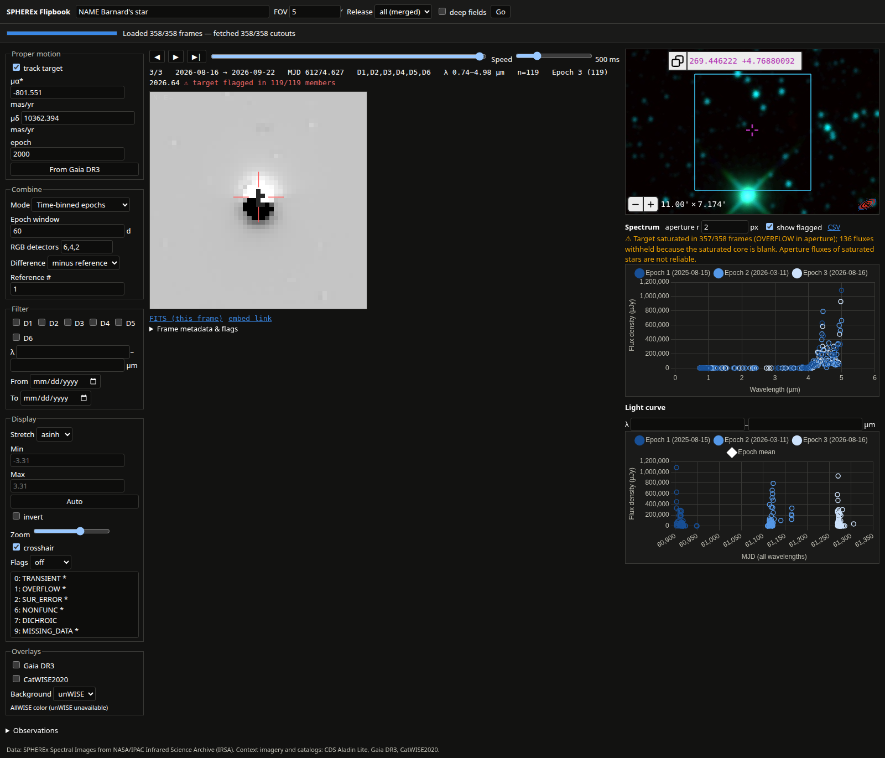 |

### ε Indi B: the pair against the bright primary ✅
- ε Indi A lies 6.7′ from B, outside a 5′ field, so the check also runs at 15′.
- In the D1 stack (0.75–1.1 µm), B is barely detected (≈2 mJy) while A dominates the
  field. In the D5 stack (3.8–4.4 µm), B is bright (≈50 mJy at S/N ≈ 124).
- B's SPHEREx spectrum shows the classic T-dwarf shape: flux peaks in the J, H and K
  windows, methane absorption between them and near 3.3 µm, and the strongest peak near
  4.1 µm.
- Ba and Bb are 0.7″ apart and **cannot be resolved** with 6.15″ pixels. "The pair" here
  means B relative to A.

| D1 stack (15′) | D6 stack (15′) | B: D5 stack + spectrum |
|---|---|---|
| 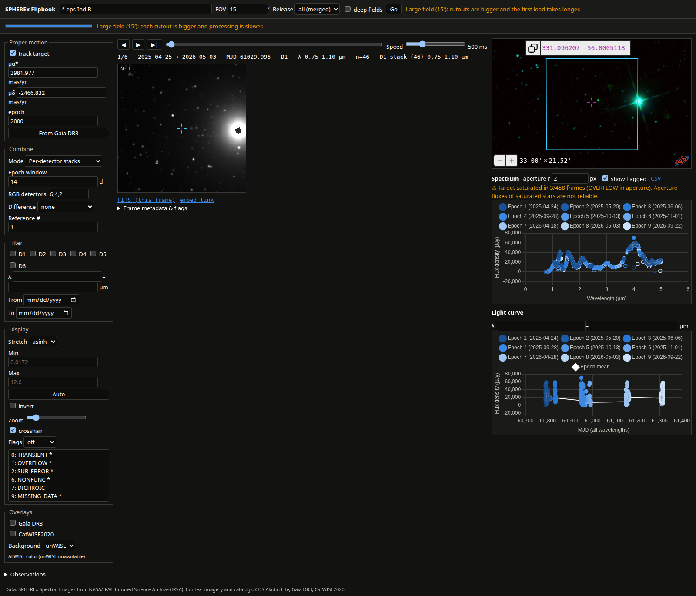 | 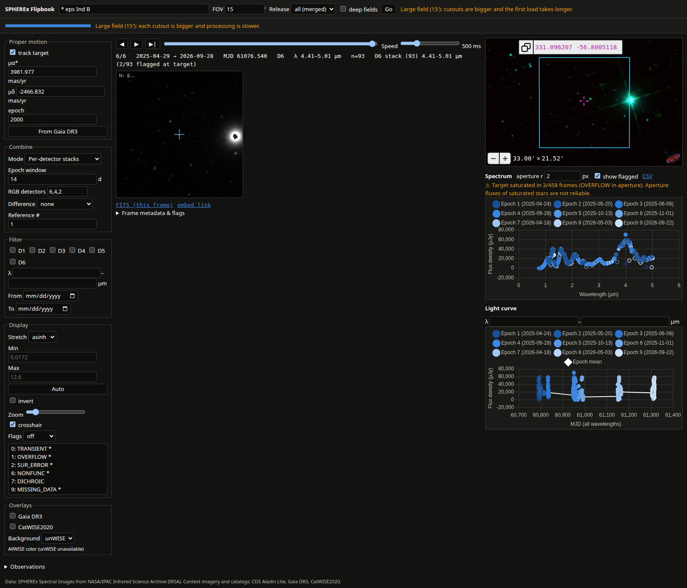 | 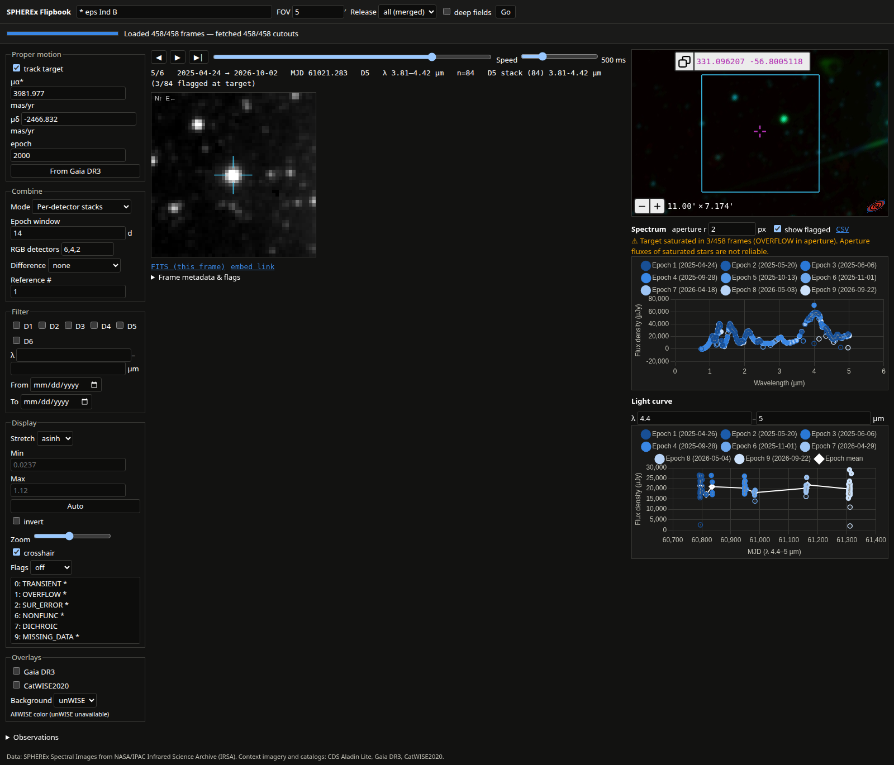 |

### WISE 0855−0714: red, fast, mostly in D5–6 ✅ (with a caveat)
- The brief's coordinates (08h55m10.831s −07°14′42.53″) are at about epoch 2010.4. By
  2025–26 the object is about 2′ west of them. The check uses Sesame's J2000 position and
  its proper motion (−8.12, +0.67 ″/yr), so the cutouts are centred on its 2025.9
  position.
- In the D5 and D6 stacks, the source peaks within 0.5 px of the predicted position. In
  D1–D4 the brightest nearby source is elsewhere.
- Measured motion over 1 yr: 1.09 px, against 1.31 px predicted (residual 0.21 px; the
  source has S/N of only about 3–4 per frame in D6).
- **Caveat:** the aperture flux in D1–D4 (~1 mJy at 1 µm) does not come from WISE 0855.
  Gaia DR3 5756956644387831296 (G = 16.3) lies **7.7″** from WISE 0855's 2025.9 position,
  within the 12″ aperture, and SPHEREx can't separate the two. Blank-sky apertures nearby
  return 0 within the errors, so the photometry itself is unbiased.

| D5+D6 epoch 1 (2025.34) | D5+D6 epoch 3 (2026.33) | Epoch 3 − epoch 1 |
|---|---|---|
| 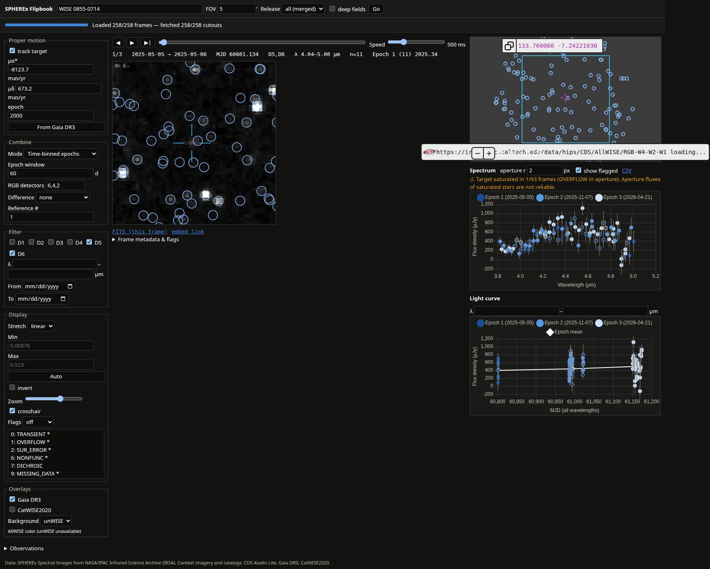 | 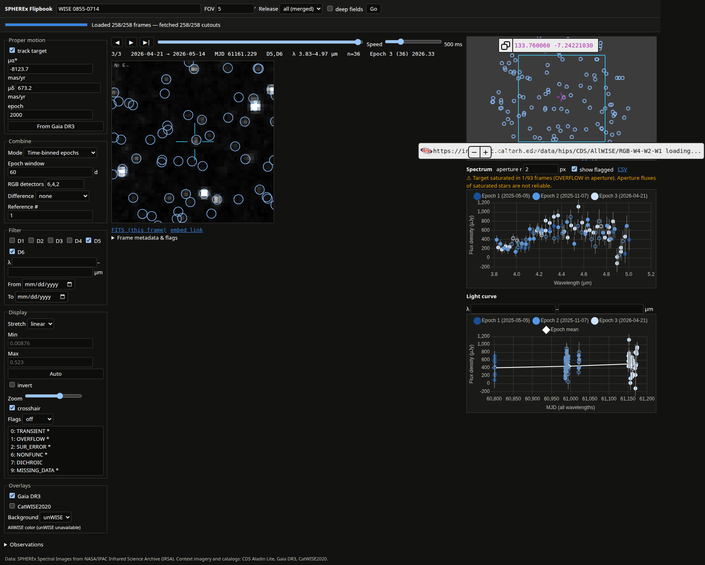 | 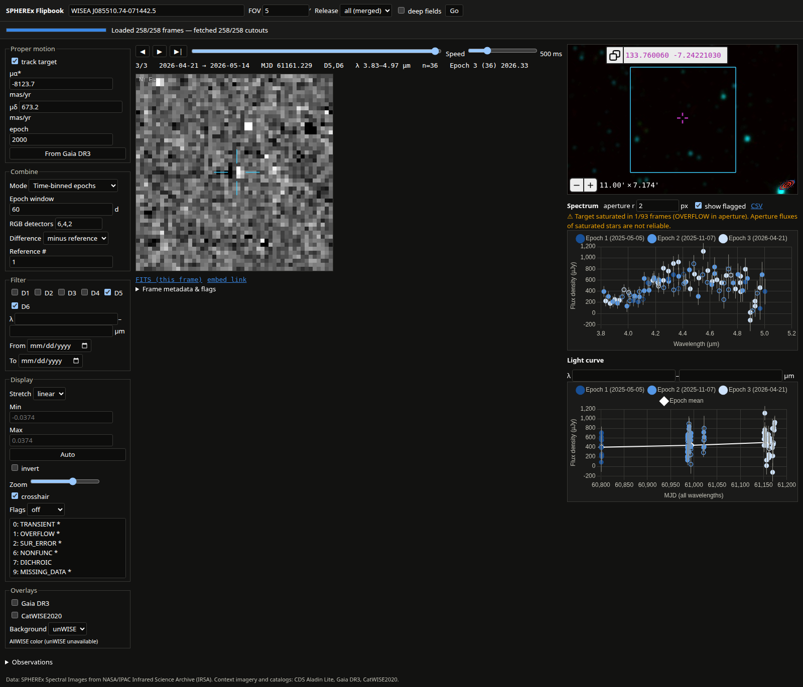 |

### RW Aur and R Dra: variability in light curve and spectra ❌ (not measurable)
- Both stars are **saturated in nearly every frame**: RW Aur in 306/335 and R Dra in
  534/539, with OVERFLOW, SUR_ERROR and BLOOM in the aperture.
- R Dra's core is blanked by the pipeline, so its fluxes are withheld.
- RW Aur's finite "fluxes" are unreliable. D6 gives ≈0.65 Jy, where W2 ≈ 4.3 mag implies
  ≈3 Jy, and D4 collapses to ~1 mJy.
- The 18 unflagged RW Aur D1 points (≈150 mJy) are suspicious for the same reason and
  should not be trusted.
- The tool reports all of this explicitly (warning text and hollow points). It doesn't
  plot a misleading light curve.
- **Fix (Phase 2):** PSF fitting to the unsaturated wings, using the per-exposure EPSF
  tables included in each cutout.

| RW Aur frame with saturation flags overlaid | R Dra D1 stack |
|---|---|
| 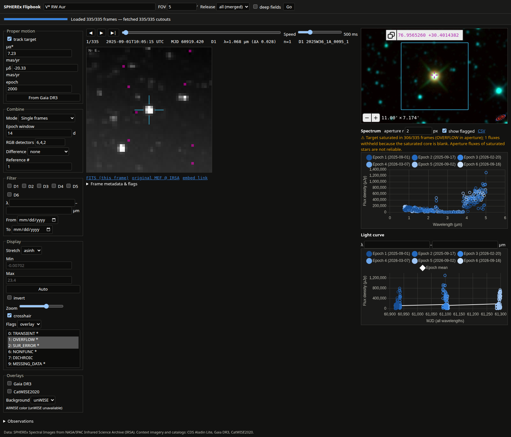 | 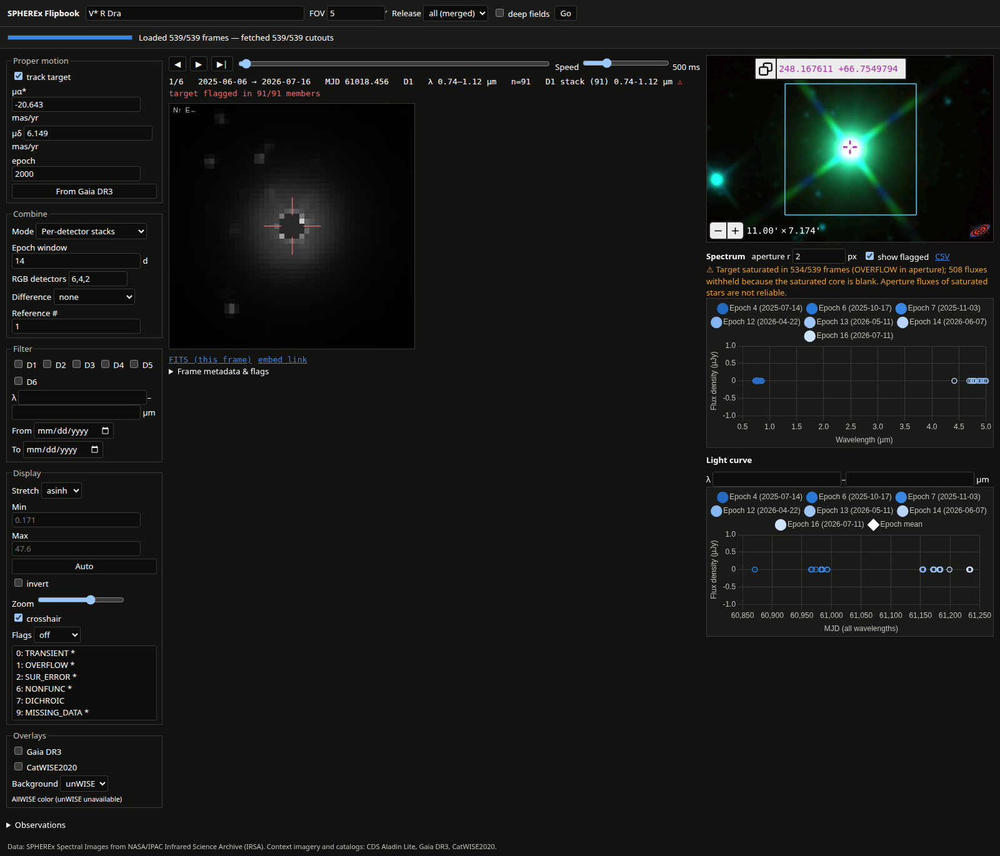 |

## S3 cutouts (first-load speed-up)

- **Equivalence with IBE:** 24 cutouts across two targets and detectors 2, 3, 5 and 6
  were built from S3 byte ranges and compared with IBE cutouts of the same images. All
  were identical: every pixel of IMAGE, FLAGS, VARIANCE and ZODI, the target's pixel
  position (Δ < 1e-6 px), the wavelength at the target, and the flag definitions.
- **End to end:** the WISE 0855 acceptance check, rerun with an empty cache and
  `SPX_CUTOUT_SOURCE=s3`, gave identical results: 258/258 frames, alignment median
  0.077 px and RMS 0.494 px, 258 measured and 203 unflagged spectrum points, the same
  median fluxes, and motion 1.307 → 1.092 px.
- **Cold first loads through the server:**

  | Target | Frames | Source | Total | First frame | 90% done |
  |---|---|---|---|---|---|
  | WISE 0855 (originally) | 258 | IBE | 348 s | — | — |
  | WISE 0855 | 258 | S3 | 41 s | — | — |
  | Polaris (S3 concurrency 64) | 413 | S3 | 89 s | 10 s | 80 s |
  | Fomalhaut (concurrency 128, the default) | 374 | S3 | 58 s | 11 s | 54 s |

  An earlier version predicted header offsets too aggressively, so some reads landed past
  the end of smaller files (HTTP 416) and 57 of 420 frames fell back to IBE. The fix
  requests headers only up to the next variable-size plane, and doesn't retry 4xx
  errors. Fallbacks dropped to zero.

## Unit tests (offline)

`backend/tests/test_units.py` has 66 tests (59 before the Talasuri refactor; the new ones are listed below):
- **Coordinate parsing:** decimal, sexagesimal, h/m/s and d/m/s, Unicode minus and primes,
  out of range, names.
- **Sesame:** XML parsing.
- **Proper motion:** propagation.
- **Wavelength extraction:** compared with a direct bilinear interpolation of the
  `WCS-WAVE` lookup table on a real DR1 cutout (fixture without the 4 MB EPSF table).
- **FLAGS:** bit definitions parsed from header keywords.
- **Stacking weights:** inverse-variance values, √N noise, masking.
- **Epoch grouping and modes.**
- **Difference images.**
- **Aperture photometry:** injected-source recovery and withholding the flux for a blank
  saturated core.
- **Grid orientation.**
- **Stretches.**
- **Release-name parsing and priority deduplication.**
- **Fast reprojection:** matches the `reproject` package (same footprint, flags, values
  to 1e-5).
- **Cache slimming:** keeps the 4 nearest PSFs, leaves the data identical, and is
  idempotent.
- **Sesame:** falls back to the mirror and caches resolved names on disk.
- **S3 cutouts:** a synthetic archive file (plain IMAGE/VARIANCE/ZODI, RICE-compressed
  FLAGS) served through a fake S3 with byte ranges. The cutout must equal a direct crop,
  preserve the WCS and wavelengths, reuse a learned layout for a file whose FLAGS plane
  compresses to a different size, and report no overlap for an off-image position.
- **Name suggestions:** normalisation, Greek/constellation expansion, ranking of the
  obvious object first ("m31" → M 31, "epsilon indi b" → eps Ind B, "wise 0855" →
  WISE 0855-0714), proper motion carried for Barnard's Star, deduplication, the
  Solar-System note, and coordinate input.

`frontend/tests/state.test.ts` has 5 URL-state tests:
- defaults round-trip;
- a fully customised state round-trips exactly and serialises stably;
- 200 random states round-trip;
- the brief's example URL parses (including `diff=0`);
- invalid values fall back to defaults and are reported.

## Talasuri redesign and Sky Sphere (2026-11-14)

The refactor, the redesign and the sphere were checked against the same live targets; the
before/after table is in [REFACTOR.md](REFACTOR.md). All six checks pass with the same
numbers as in the table above.

New offline tests:
- **Shared coordinate cases** (`shared/coords_cases.json`): the Python and TypeScript
  coordinate modules must agree on 56 parse cases and 41 format cases; sexagesimal output is
  also compared with astropy on 200 random positions.
- **Pipeline:** stacks are computed once and reused by every difference mode.
- **Renderer:** PNG and WebP decode to identical pixels; grey frames are a neutral ramp.
- **Cutouts:** three concurrent requests for one cutout make one download; the fourth is
  served from disk.
- **Sky sphere** (`frontend/tests/sphere.test.ts`): RA/Dec → vector → RA/Dec round-trips
  over the whole sky; in the inside view east is to the left and north up; in the outside
  view east is to the right; screen → RA/Dec inverts RA/Dec → screen in both modes (click
  picking); the mode transition is continuous; the ecliptic and galactic plane pass through
  the equinoxes and Sgr A*.
- **URL schema:** `view` and `sphere` parse, default to `flipbook` / `inside`, reject
  invalid values, and old `tab=` links still load.

Checked in a headless browser (`scripts/screenshots.py`, screenshots in `docs/screenshots/talasuri_*.png`):
flipbook, difference imaging, sphere inside, sphere outside (with its "mirrored" badge),
picking on the SPHEREx layer, Aladin, the empty state, help, `?embed=1`, and a 390 px phone
with a bottom sheet open. No console errors except Aladin's known CDS hostname error.
Not checked by a person: screen readers, real touch devices, Safari and Firefox.

## Known issues found during testing
- **Aladin Lite's CDS URLs fail.** The CDS-hosted `api/v3/latest/aladin.js` returned 404,
  so the app loads `aladin-lite@3.8.2` from jsDelivr. CDS HiPS tiles also returned 404
  today. The background falls back to IRSA-hosted copies: AllWISE for unWISE, and 2MASS.
  DSS has no IRSA copy. A legacy CDS mirror hostname doesn't resolve in this environment,
  which is the source of the remaining browser console errors.
  The default background is now the SPHEREx DR1 all-sky HiPS cube (IRSA). Aladin 3.8.2's
  `setSliceNumber()` loads the wrong slice for this cube; the direct-from-IRSA fallback selects slices by frequency (`aladin.ts`).
- **The SPHEREx sky map went blank on every zoom step.** Aladin 3.8.2 draws a HiPS cube with
  no lower-resolution fallback, and IRSA takes ~1 s per tile, so the map vanished for 1–2 s
  per step (measured: map pixel std 0.2 for 1.25–1.75 s; 2MASS stayed visible). The backend
  now re-serves each slice as an image HiPS with a disk tile cache (`data_access/hips.py`).
  Re-measured on 3 zoom-ins and 3 zoom-outs at 120–250 ms sampling: the map is never blank;
  a cached tile is served in <1 ms instead of 0.6–1 s.
- **IRSA TAP is slow.** It took minutes, so collection discovery samples the ecliptic
  poles (~20 s), and catalogs use IRSA Gator (~2 s).
- **Docker untested.** The Docker build couldn't run here: no permission on the Docker
  socket.
- **No cancel endpoint.** A session that's no longer wanted keeps fetching until the LRU
  evicts it.

## Motion prediction and mover classifier (2026-11-15)

Offline unit tests (`backend/tests/test_units.py`, 14 new):

- **Geometry:** tangent-plane round trip and orientation; parallax factors against an
  independent vector calculation (observer moved to the Earth's position).
- **Fit:** recovers proper motion and parallax from simulated WISE-like epochs with two
  field stars near the track; drops an undetected parallax; refuses too few visits, too
  short a baseline and a position with no detections; warns when under half the visits
  yield a detection.
- **Uncertainty:** over 300 simulated data sets the true future position falls inside the
  95% ellipse at least 93% of the time; the ellipse grows with time; axes and position
  angle of known covariances.
- **Endpoint:** `POST /api/wise_motion` with canned detections (cone radius, predictions,
  cached fit, range check).
- **Classifier:** feature units and missing values; the numpy tree evaluator on a
  hand-built tree; the shipped model reproduces the probabilities scikit-learn gave at
  training time; Gaia matching at the CatWISE epoch; `GET /api/movers` ranking, the
  no-model (503) case, and that strong non-Gaia sources survive the list cap.

Live checks against IRSA (WISE 0855−0714, Barnard's Star, ε Indi B) and the classifier's
cross-validation scores are in the README. Browser checks (headless Chromium, 1600×1000
and 420×800): the prediction mark and Telemetry readout on WISE 0855−0714, the Movers tab
list, row selection, *Open as target*, no horizontal overflow on a phone, no console errors.

The SIMBAD brown-dwarf positives were added after the first model scored WISE 0855−0714
at P = 0.10; the held-out scores before and after are in the README. The brown-dwarf
download and matching (`train_movers.py`) have no unit test; they were run live once.

Not tested: the Movers tab near the Galactic plane (outside the training range), fits for
objects fainter than the single-exposure limit, and the `scripts/screenshots.py` run after
these changes.
